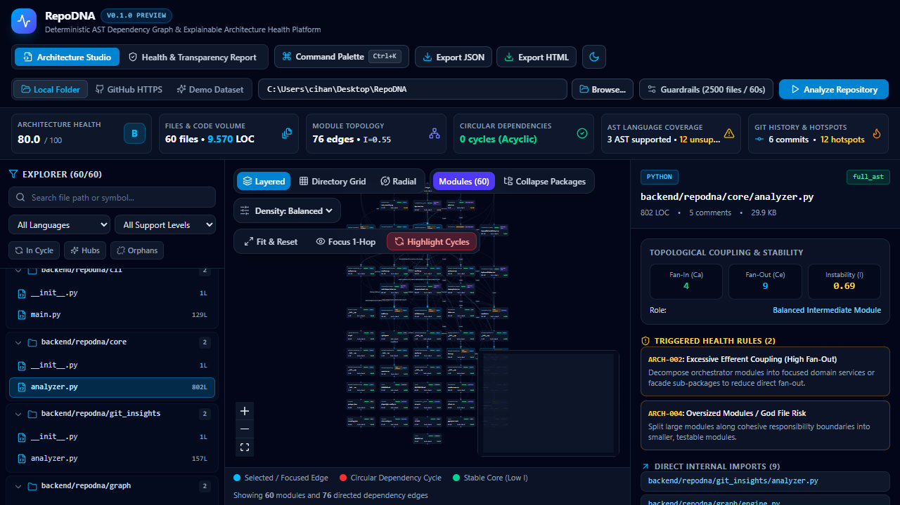
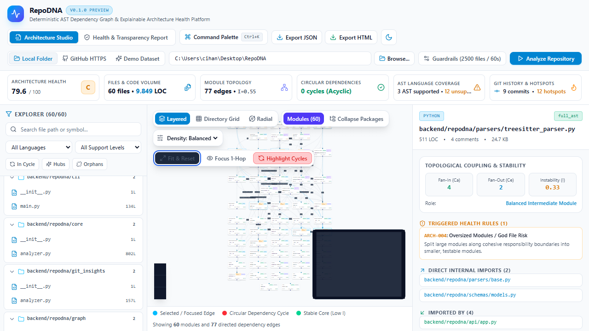
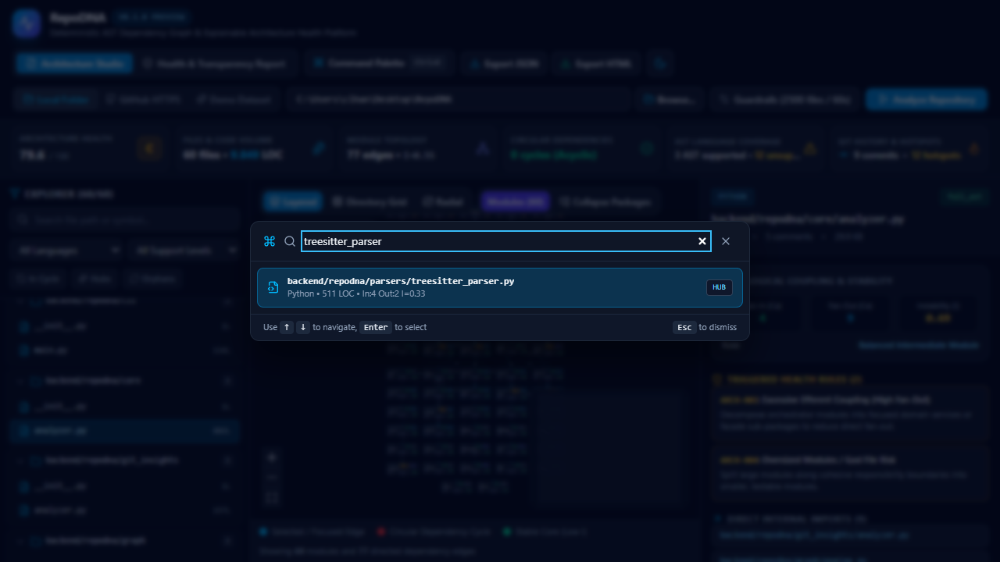
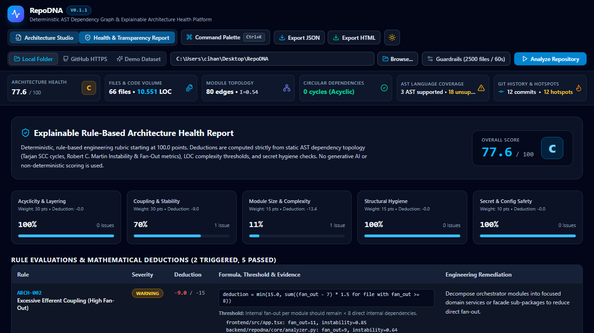
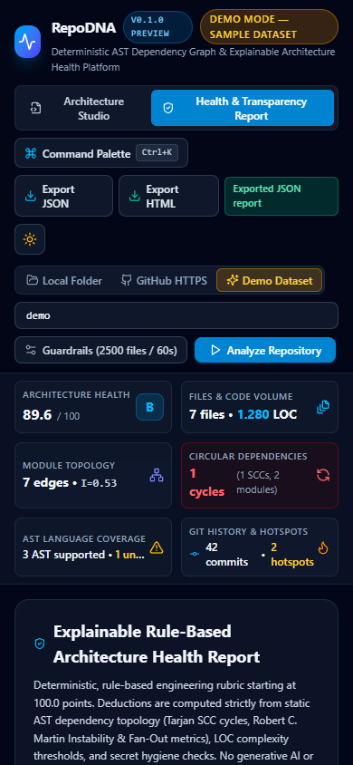
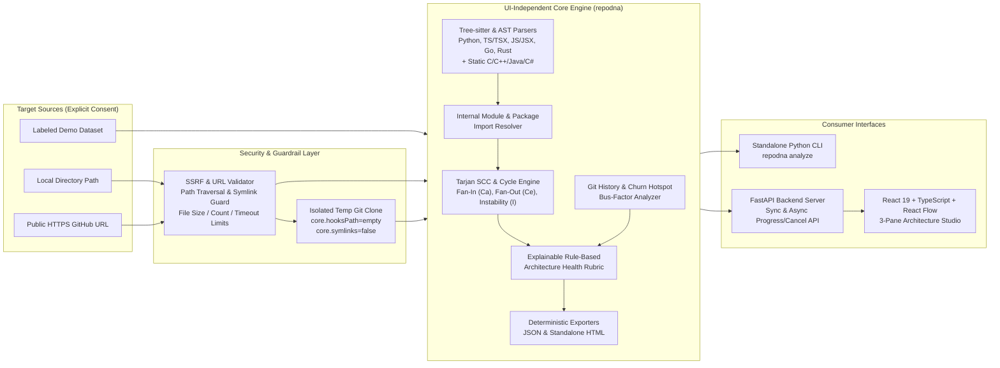

# RepoDNA — Developer Repository Intelligence Platform

[](https://github.com/Cihanak1/RepoDNA/actions/workflows/ci.yml)
[](https://github.com/Cihanak1/RepoDNA/releases)
[](https://www.python.org/)
[](https://www.typescriptlang.org/)
[](./LICENSE)

**RepoDNA** is a static architectural analysis, module dependency graph, circular dependency detector, and explainable code health platform for local source directories and public GitHub repositories.

Built for software architects, staff engineers, and open-source maintainers, RepoDNA parses source repositories using **Tree-sitter CST/AST parsers** without executing a single line of target code. It maps internal module relationships, identifies strongly connected circular dependency chains via **Tarjan's SCC algorithm**, calculates **Robert C. Martin's Instability ($I$) and Fan-In/Fan-Out coupling metrics**, inspects Git commit churn hotspots, and produces a **100% deterministic, rule-based Architecture Health Report**.

---

## Screenshots (Real Browser Verification)

| Architecture Studio (Dark Theme) | Architecture Studio (Light Theme) |
| :---: | :---: |
|  |  |

| Command Palette (`Ctrl+K`) | Explainable Health & Transparency Report | Responsive Mobile View |
| :---: | :---: | :---: |
|  |  |  |

---

## System Architecture



### Module Structure

```text
RepoDNA/
├── pyproject.toml                  # Python 3.12+ package, CLI entrypoint, Ruff/Mypy/Pytest config
├── README.md                       # English architecture, setup, usage, security & test documentation
├── LICENSE                         # MIT License
├── SECURITY.md                     # Threat model, SSRF/symlink/secret boundaries & vulnerability policy
├── CONTRIBUTING.md                 # Contribution guidelines & development workflow
├── CHANGELOG.md                    # Release history
├── .github/workflows/ci.yml        # GitHub Actions CI pipeline
├── backend/
│   ├── repodna/
│   │   ├── schemas/models.py       # Typed Pydantic v2 data contracts
│   │   ├── security/validators.py  # HTTPS GitHub URL allowlist, SSRF block, symlink & secret guards
│   │   ├── storage/workspace.py    # Hardened temporary Git clone & automatic cleanup
│   │   ├── parsers/                # Tree-sitter AST & static import/symbol extractors + path resolver
│   │   ├── graph/engine.py         # Tarjan SCC, elementary cycle finder, Fan-In/Out & Instability (I)
│   │   ├── git_insights/analyzer.py# Read-only Git commit history, bus-factor & churn hotspot calculator
│   │   ├── rules/health.py         # Explainable rule-based Architecture Health engine
│   │   ├── reports/exporter.py     # Deterministic JSON & standalone self-contained HTML report generator
│   │   ├── core/analyzer.py        # Orchestrator with progress callbacks, cancellation & timeouts
│   │   ├── api/app.py              # FastAPI server (sync scan, async jobs, cancel, exports, safe browse)
│   │   └── cli/main.py             # Standalone Python CLI scanner
│   └── tests/                      # Pytest unit, security, graph, CLI & FastAPI integration suite
└── frontend/
    ├── src/
    │   ├── api/client.ts           # Typed API client
    │   ├── types/repodna.ts        # TypeScript domain models
    │   ├── utils/graphLayout.ts    # Deterministic Layered, Cluster & Radial graph layouts + filters
    │   ├── components/             # 3-Pane Studio (HeaderBar, SummaryStrip, ExplorerSidebar,
    │   │                           # DependencyGraph, InspectorPanel, HealthReportView, FolderBrowserDialog)
    │   └── __tests__/              # Vitest component & layout unit tests
    └── e2e/repodna.spec.ts         # Playwright real-browser end-to-end verification suite
```

---

## Key Features

1. **Explicit Consent Local Scanning & Hardened GitHub Cloning**:
   - Never scans local directories automatically in the background; local scans begin only when explicitly triggered by the user.
   - Clones public `https://github.com/<owner>/<repo>` repositories into disposable temporary directories with Git hooks (`core.hooksPath`) and symbolic links (`core.symlinks=false`) disabled. Source code is **never** executed.
2. **Multi-Language Tree-sitter AST & Static Import Resolution**:
   - **Full AST Support (`full_ast`)**: Python (`.py`), TypeScript (`.ts`, `.tsx`), JavaScript (`.js`, `.jsx`, `.mjs`, `.cjs`), Go (`.go`), and Rust (`.rs`).
   - **Partial Static Support (`partial_static`)**: C/C++ (`.c`, `.h`, `.cpp`, `.hpp`), Java (`.java`), Kotlin (`.kt`), and C# (`.cs`).
   - **Full Transparency (`unsupported`)**: Files in other languages (`.rb`, `.php`, `.swift`, `.sql`, `.yaml`, `.md`, etc.) are counted in LOC and language distribution and explicitly listed under **Unsupported Languages** in the Transparency Report. Dynamic imports (`__import__`, `import(expr)`) and unresolved relative paths are explicitly reported with line numbers.
3. **Explainable, Rule-Based Architecture Health Rubric**:
   - Zero hallucinated AI scores. For non-empty repositories, the rubric starts at `100.0` points (`status="evaluated"`); for empty repositories (`0` files), RepoDNA reports `overall_score=null`, `grade="N/A"`, and `status="insufficient_data"` so missing data is never misrepresented as a perfect 100/100 score.
   - Evaluates deterministic engineering rules with explicit mathematical formulas, thresholds, evidence, and remediation:
     - `ARCH-001`: **Circular Dependency Violations (ADP)** — Tarjan SCC (`scc_count`) & Johnson blocked-set elementary cycle enumeration (`cycle_count`, bounded by `max_cycles=25` per SCC, `max_total_cycles=100`, `25,000` operations, and `0.75s` timeout per SCC with `cycles_truncated` disclosure). `deduction = min(30.0, 6.0 * cycle_count + 1.2 * nodes_in_cycles)`.
     - `ARCH-002`: **Excessive Efferent Coupling (High Fan-Out)** — Flags modules importing $\ge 8$ internal modules. `deduction = min(15.0, sum((fan_out - 7) * 1.5))`.
     - `ARCH-003`: **Stable Dependencies Principle (SDP) Inversion** — Flags stable modules ($I \le 0.35$, `fan_in >= 2`) depending on volatile modules ($I \ge 0.70$, $\Delta I \ge 0.40$). `deduction = min(15.0, 3.0 * sdp_violation_edges)`.
     - `ARCH-004`: **Oversized Modules / God File Risk** — Flags code modules exceeding `450` non-comment LOC. `deduction = min(15.0, max(2.0, sum((lines_code - 450) / 100 * 2.0)))`.
     - `ARCH-005`: **Isolated / Orphaned Modules** — Flags non-entrypoint modules with zero internal graph edges when $\ge 3$ orphans or $> 25\%$ of code files. `deduction = min(10.0, 1.5 * orphan_files_count)`.
     - `ARCH-006`: **Excessive Directory Hierarchy Depth** — Flags paths nested $\ge 6$ levels deep. `deduction = min(5.0, max(1.0, 0.5 * files_with_depth_ge_6))`.
     - `SEC-001`: **Potential Secret or Sensitive File Exposure** — Flags committed `.env` / private key files or high-confidence token patterns (with values redacted). `deduction = min(20.0, 7.5 * files_with_secret_warnings)`.
4. **Interactive 3-Pane Architecture Studio**:
   - **Left (Repository Explorer)**: Search by file path or AST symbol name, filter by language or AST support level, and toggle quick filters for **In Cycle**, **Hubs**, and **Orphans**.
   - **Center (Interactive Dependency Graph)**: Powered by `@xyflow/react` with **Layered Hierarchy**, **Directory Clusters**, and **Radial Ring** layouts, **Zoom/Pan/FitView**, **MiniMap**, **1-Hop Neighborhood Focus**, and **Circular Dependency Highlighting**.
   - **Right (Module Deep Inspector)**: Inspect per-file LOC, Fan-In ($C_a$), Fan-Out ($C_e$), Instability ($I$), participating Circular Dependency chains, clickable internal imports & dependents, external packages, unresolved/dynamic imports, AST symbols, Git churn, and triggered health rules.
5. **JSON & Standalone HTML Export**:
   - Export complete machine-readable JSON or a self-contained, dark/light-aware HTML executive architecture report from either the Web UI or the CLI.

---

## Installation & Quick Start

### Prerequisites
- **Python**: `3.12+`
- **Node.js**: `20+` (tested with Node.js LTS)
- **Git**: Installed and available on `PATH`

### 1. Backend & Standalone CLI Setup

```bash
# Install backend package and development/test dependencies
python -m pip install -e ".[dev]"

# Verify CLI help
python -m repodna.cli.main --help
```

### 2. Frontend Setup

```bash
cd frontend
npm install
```

### 3. Running the Full-Stack Platform

Start the FastAPI backend server on port `8000`:

```bash
python -m uvicorn repodna.api.app:app --host 127.0.0.1 --port 8000
```

In a second terminal, start the Vite development server on port `5173`:

```bash
cd frontend
npm run dev
```

Open `http://127.0.0.1:5173` in your browser.

---

## Standalone CLI Usage

RepoDNA's core analysis engine runs independently of the web UI via `python -m repodna.cli.main`:

```bash
# Analyze a local directory and print an executive summary table
python -m repodna.cli.main analyze .

# Export a deterministic JSON report
python -m repodna.cli.main analyze . --format json --output repodna-report.json

# Export a standalone, self-contained HTML report
python -m repodna.cli.main analyze . --format html --output repodna-report.html

# Analyze a public HTTPS GitHub repository with custom file/timeout guardrails
python -m repodna.cli.main analyze https://github.com/Cihanak1/AImage --max-files 1500 --timeout 45

# Run against the explicitly labeled Demo showcase dataset
python -m repodna.cli.main analyze demo --format table
```

---

## Limitations & Transparency

- **Static Analysis Scope**: Dynamic runtime reflection, metaprogramming (`eval`, dynamic `importlib.import_module(var)`), or dependency injection containers wired via external XML/YAML files cannot be statically linked to a target file. RepoDNA explicitly records dynamic import calls under `unresolved_imports` with `reason="dynamic_import"` so they are never silently hidden.
- **Git Churn & Bus-Factor Estimation Boundaries**:
  - **Window**: Inspects up to `max_commits=200` recent commits via read-only `git log -n 200 --date=short --pretty=format:COMMIT%x1f%h%x1f%an%x1f%ad%x1f%s --name-only` with `-c core.quotepath=false`.
  - **Hotspot Churn Risk Formula**: $\text{ChurnRisk} = \text{commits} \times \log_2(\max(\text{LOC}, 10))$, ranking the top 12 frequently modified high-LOC modules.
  - **Bus-Factor Heuristic**: Counts the minimum number of top contributors required to account for $\ge 60\%$ of scanned commits. Note that this is a commit-count heuristic over the recent commit window (`--depth 50` on remote shallow clones) and does not weight line-level blame ownership or historical author email aliases unless `.mailmap` is configured.
- **GitHub Host Scope**: By design, remote cloning initially supports only canonical `https://github.com/<owner>/<repo>` URLs over port 443 to prevent SSRF against internal networks or unverified Git servers.
- **Large Monorepo Guardrails**: Default scan limits (`max_files=2500`, `max_file_size_bytes=1MB`, `max_total_size_bytes=100MB`, `timeout_seconds=60s`) protect workstation memory and CPU. These limits are user-configurable in both the UI (**Guardrails** dialog) and CLI (`--max-files`, `--max-file-size`, `--timeout`), and any truncation is prominently reported in `transparency.truncated_by_limits`.

---

## Performance Benchmarks

Measured on **Windows 11 (Python 3.12.10, Tree-sitter 0.25.2, Microsoft Edge Headless via Playwright)** across deterministic multi-language fixture repositories (Python, TypeScript, Go, Rust) using median of 3 warmed-up runs (`tracemalloc` peak memory measured in a dedicated pass):

| Repository Tier | Files & Edges | Scan Duration (Before → After) | Parse Duration (Before → After) | Graph Construction | Peak Memory (`tracemalloc`) |
| :--- | :--- | :--- | :--- | :--- | :--- |
| **Small** | 30 files, 33 edges | `27.24 ms` → **`20.08 ms`** | `12.30 ms` → **`10.48 ms`** | `0.89 ms` | `1.16 MB` |
| **Medium** | 180 files, 239 edges | `160.24 ms` → **`116.02 ms`** | `76.50 ms` → **`65.69 ms`** | `4.54 ms` | `1.96 MB` |
| **Large** | 600 files, 816 edges | `512.43 ms` → **`458.09 ms`** | `247.78 ms` → **`251.10 ms`** | `19.50 ms` | `5.94 MB` |
| **Adversarial Cyclic Mesh** | 16 files, 80 bidirectional edges (`1` SCC, `25` capped cycles, `cycles_truncated=True`) | **`39.52 ms`** | — | Bounded by `max_cycles=25` / `25k` ops | `1.09 MB` (Cancel latency: `1.63 ms`) |

- **Browser UI Responsiveness (Live 60-file Repository)**:
  - Initial Application Render: `294 ms`
  - Module Selection & Inspector Update Latency: `40 ms`
  - Directory Package Collapse (`60 modules` → `23 package clusters`): `486 ms` (including `fitView` layout transition)

---

## Roadmap

- **`v0.2.0`**: Full Tree-sitter AST import & package resolution for Java, Kotlin, C#, and Ruby (`Gemfile` / `require_relative`).
- **`v0.3.0`**: Call-graph symbol-level edge resolution and SARIF export for GitHub Code Scanning integration.
- **`v0.4.0`**: Web Worker off-thread force-directed layout for 5,000+ node monorepos and diff-mode architecture comparison between two Git refs.

---

## Testing, Linting & Verification Commands

### Backend Verification

```bash
# Run pytest unit & integration suite (44 tests)
python -m pytest -v

# Run Ruff linter
python -m ruff check backend

# Run Mypy static type checker
python -m mypy backend
```

### Frontend Verification

```bash
cd frontend

# Run TypeScript compiler typecheck
npm run typecheck

# Run Vitest unit tests
npm test

# Build production bundle
npm run build
```

### End-to-End Browser Verification (Playwright)

```bash
cd frontend
npx playwright test
```

---

## License

Released under the [MIT License](./LICENSE).
